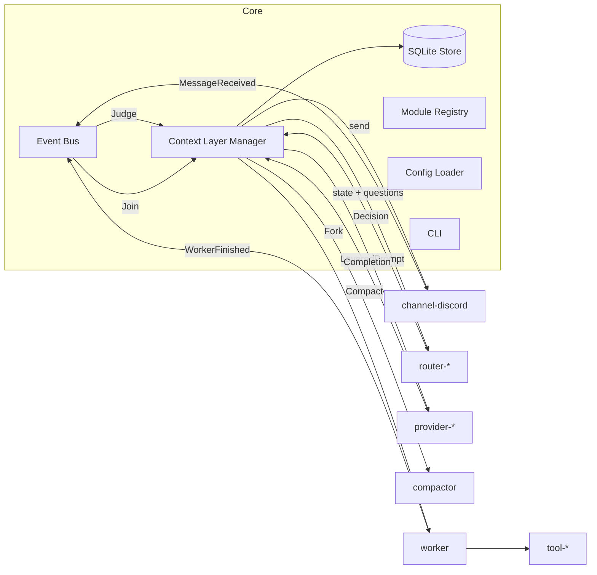

# Noth アーキテクチャ仕様: Core と module

Noth は少人数の Discord サーバーに常駐する AI エージェントハーネスです。本書は Rust アプリケーションとしての分割単位(Core と module)、module 同士の境界、ビルド時に必要な機能だけを組み込む仕組み、採用クレートを定義します。

会話文脈の扱い(Layer 0〜4、System One による制御、ライフサイクル)は [context-layers.md](context-layers.md)、CLI と設定ファイルは [cli.md](cli.md) を参照してください。

## 1. 設計原則

1. **Core は小さく、機能は module に置く。** Core は「イベントを流す」「文脈を組み立てる」「状態を永続化する」「module を束ねる」だけを担う。Discord・LLM・System One・ツールはすべて module。
2. **必要な module だけを静的リンクする。** module の有効化は Cargo feature で行い、1バイナリに必要な分だけ含める。実行時プラグインロードや外部プロセス接続は MVP では持たない。
3. **module は Core の公開 trait にだけ依存する。** module 同士は直接参照しない。module 間のやり取りは Core のイベントバスと trait 経由に限る。
4. **module を外したときの退化動作を定義する。** 任意 module が無い構成でも Core は起動し、仕様で決めた縮退動作に落ちる。
5. **各サービスは公式の標準 API を直接使う。** LLM・System One・TinyFish はいずれも `reqwest` で公式 HTTP API を叩く。SDK やラッパーは挟まない。

## 2. 全体像



Context Layer Manager は本線の状態を持つ唯一の writer(actor)で、`Judge` / `Join` / `Compact` の仕事を1本のキューから順に処理します。並行に動くのは Worker だけです([context-layers.md §2.1](context-layers.md#21-本線-actor-と処理単位))。

## 3. module 一覧

命名規則は `<種別>-<実装>`。この名前を Cargo feature 名、クレート名(`noth-` 接頭辞付き)、`config.toml` の `[modules] enabled` の要素、`noth module` コマンドの引数で **そのまま共通に使います**。

### 3.1 Core(必須、feature 化しない)

| コンポーネント | 責務 |
|---|---|
| Config Loader | `config.toml` と `.env` の読み込み、`${VAR}` の解決、検証。解決するのは有効な module のセクションだけ |
| CLI | `noth` コマンド群。[cli.md](cli.md) 参照 |
| Event Bus | module 間のイベント配送。`MessageReceived`、`WorkerFinished`、`IdleDetected` |
| Context Layer Manager | 本線 actor。Layer 0〜4 の構築と Append-only 保証、Fork/Join、未昇格バッファの管理、閾値による判定の二値化、Compactor の置換。本線状態の唯一の writer |
| SQLite Store | 生ログ、TopicChunk、エピソード要約、Worker 結論メモ、heartbeat の永続化。`guild_id` でキー付け |
| Module Registry | feature で組み込まれた module の初期化順序と依存解決、設定で有効化された module のみ起動 |

### 3.2 必須だが差し替え可能

router と provider は **有効なものがちょうど1つ** でなければ起動しません。channel は1つ以上。

| 種別 | module | 内容 |
|---|---|---|
| channel | `channel-discord` | Discord への接続、発言の受信とデバウンス、Bot からの投稿 |
| router | `router-systemone` | System One API(Jev / Clef)で介入判定・ノイズ判定・話題区切り・関連チャンク選択・合流判定を行う |
| router | `router-mention` | ルールベース。メンション・リプライ・キーワード一致時のみ `reply_only`、他は `silent`。話題区切りは「前の発言から一定時間空いた、またはチャンネルが変わった」で判定し、関連チャンクは常に空。System One を契約していなくても起動でき、テストにも使う |
| provider | `provider-openai` | OpenAI Chat Completions 形式。Responses 形式も同 module 内で選べる |
| provider | `provider-anthropic` | Anthropic Messages API |
| provider | `provider-google` | Gemini `generateContent`。認証は API キー(AI Studio)か OAuth2(Agent Platform) |

**接続先 preset**: provider は `preset` 設定で接続先(ベース URL、認証方式、モデル ID とプロトコルの対応)を切り替えます。preset は module ではなく各 provider module 内のテーブルです。

| preset | 対象 provider | 内容 |
|---|---|---|
| (省略) | すべて | ベンダー直結(OpenAI / Anthropic / Google AI Studio) |
| `opencode-go` | openai / anthropic / google | ベース URL `https://opencode.ai/inference/go/v1`。モデル ID ごとに Chat Completions / Responses / Messages / Google 形式のいずれかを使う。利用者は使いたいモデルの形式に合う provider module を有効にする |
| `agent-platform` | google | Google Agent Platform(旧 Vertex AI)。`project` / `location` とサービスアカウントの OAuth2 |

### 3.3 任意

| 種別 | module | 内容 | 無効時の退化動作 |
|---|---|---|---|
| worker | `worker` | Ephemeral Task Worker。本線から Fork した隔離コンテキストで tool を使い、結論メモだけを返す | router の `spawn_task` 判定を `reply_only` に降格する。本線に tool 定義を渡さない |
| compactor | `compactor` | アイドル時に Layer 3 を三人称要約へ圧縮し Layer 2 へ統合する | Layer 3 がハード上限を超えたら古い TopicChunk を要約せず破棄する |
| tool | `tool-web-search` | Web 検索。バックエンドは `tinyfish`(Search API) | worker の `web_research` / `fact_check` で検索できない旨を結論メモに書く |
| tool | `tool-web-fetch` | URL の本文取得。バックエンドは `tinyfish`(Fetch API) | 同上 |
| tool | `tool-web-agent` | 自然言語の目標で実サイトを操作。バックエンドは `tinyfish`(Agent API `run-async` + ポーリング) | 同上 |
| tool | `tool-shell` | ホスト上でのコマンド実行。サンドボックスなし | `code_or_tool` の task は「対応ツールなし」の結論メモを返す |

tool module は `worker` が有効なときだけ意味を持ちます。`worker` 無効で tool が有効な構成は `noth doctor` が警告します。

### 3.4 共有クレート(module ではない)

| クレート | 用途 |
|---|---|
| `noth-backend-tinyfish` | TinyFish の HTTP クライアントと認証(`X-API-Key`)。`tool-web-*` の3 module が共有する |

バックエンドは tool の設定で `backend = "tinyfish"` のように選びます。MVP のバックエンドは `tinyfish` のみですが、tool の trait はバックエンドに依存しないため、後から別バックエンドを足せます。

## 4. クレート構成

Cargo workspace を使い、module ごとに1クレートにします。module の境界をクレート境界と一致させることで「Core の公開 trait にだけ依存する」制約がコンパイル時に効きます。

```text
noth/
├── Cargo.toml                    # [workspace]
├── crates/
│   ├── noth-core/                # Core。trait 定義、イベントバス、層マネージャ、SQLite
│   ├── noth-channel-discord/
│   ├── noth-router-systemone/
│   ├── noth-router-mention/
│   ├── noth-provider-openai/
│   ├── noth-provider-anthropic/
│   ├── noth-provider-google/
│   ├── noth-worker/
│   ├── noth-compactor/
│   ├── noth-tool-web-search/
│   ├── noth-tool-web-fetch/
│   ├── noth-tool-web-agent/
│   ├── noth-tool-shell/
│   └── noth-backend-tinyfish/
└── src/main.rs                   # バイナリクレート noth。feature で module を束ねる
```

バイナリクレートの `Cargo.toml` では各 module クレートを `optional = true` の依存にし、同名の feature で有効化します。

```toml
[features]
default = [
  "channel-discord", "router-systemone", "router-mention",
  "provider-anthropic", "worker", "compactor",
  "tool-web-search", "tool-web-fetch", "tool-shell",
]
channel-discord   = ["dep:noth-channel-discord"]
router-systemone  = ["dep:noth-router-systemone"]
router-mention    = ["dep:noth-router-mention"]
provider-openai   = ["dep:noth-provider-openai"]
provider-anthropic = ["dep:noth-provider-anthropic"]
provider-google   = ["dep:noth-provider-google"]
worker            = ["dep:noth-worker"]
compactor         = ["dep:noth-compactor"]
tool-web-search   = ["dep:noth-tool-web-search", "dep:noth-backend-tinyfish"]
tool-web-fetch    = ["dep:noth-tool-web-fetch",  "dep:noth-backend-tinyfish"]
tool-web-agent    = ["dep:noth-tool-web-agent",  "dep:noth-backend-tinyfish"]
tool-shell        = ["dep:noth-tool-shell"]
```

`main.rs` は `#[cfg(feature = "...")]` で各 module の登録関数を Module Registry に渡すだけにし、ロジックを持ちません。

## 5. Core の公開 trait

以下は `noth-core` が定義し、module が実装する拡張点です。シグネチャは意図を示すための骨子で、実装時にエラー型の詳細を詰めます。

trait は `Box<dyn Trait>` で Module Registry に登録するため、非同期メソッドは `async-trait` クレートで定義します(素の `async fn in trait` は `dyn` にできず、`Send` も保証されないため)。

骨子に現れる共通型:

| 型 | 内容 |
|---|---|
| `Member` | `user_id`、表示名、ロール名の一覧 |
| `IncomingMessage` | `channel_id`、`message_id`、`user_id`、本文(`content` のみ)、時刻、`is_self` |
| `Turn` | Layer 3 / 4 の1ブロック。`role`(user / assistant)、本文、種別(バッファ / トリガー / 応答 / 結論メモ / 関連チャンク)、`chunk_id` |
| `RouterState` | [context-layers.md §4.1](context-layers.md#41-state-の組み立て) の JSON |
| `CompletionParams` | `max_tokens`、effort などモデル依存の生成パラメータ |
| `ToolContext` | `run_id`、`task_category`、作業ディレクトリ、承認ポリシーへの参照 |

### 5.1 `Channel`

```rust
#[async_trait]
pub trait Channel: Send + Sync {
    /// 接続し、受信した発言を Event Bus に流す。allowed_users 以外と Bot の発言はここで捨てる
    async fn run(&self, bus: BusHandle) -> Result<()>;
    /// 発言を投稿する。2,000 文字を超えれば分割し、最後の MessageId を返す。
    /// reply_to があれば元発言へのリプライとして投稿する。allowed_mentions は常に空
    async fn send(&self, channel_id: ChannelId, text: &str, reply_to: Option<MessageId>) -> Result<MessageId>;
    /// 生成中の typing インジケータ
    async fn typing(&self, channel_id: ChannelId) -> Result<()>;
    /// Layer 1 に固定するメンバー情報。起動時に1回だけ呼ぶ
    async fn members(&self) -> Result<Vec<Member>>;
}
```

`channel-discord` が読むのはメッセージの `content` だけです。`referenced_message`(リプライ引用)、`message_snapshots`(転送)、`embeds`(URL プレビュー)、添付は読みません。これらは非リストユーザや外部サイトの文字列が入る経路だからです。`content` 内のユーザーメンションは `allowed_users` なら表示名に解決し、それ以外は `<user>` に置き換えます。メッセージの編集・削除イベントは MVP では無視します(SQLite の記録は投稿時のまま)。

### 5.2 `Router`(System One)

Router の抽象は System One API の形に合わせます。`state`(判断対象の状態)と複数の `questions` を1リクエストで渡し、各質問に確率付きの回答を得ます。質問型は API と同じ3種類だけです。質問セット自体は Core が定義し([context-layers.md §4](context-layers.md#4-system-one-判定スキーマ))、router module は「どう問い合わせるか」だけを担います。

```rust
pub enum Question {
    /// yes / no。回答は yes である確率(0.0〜1.0)
    Noul { instructions: String },
    /// 選択肢から1つ。回答は各選択肢の確率と confidence。選択肢は最大 255
    Choice { instructions: String, criteria: Vec<(String, String)> },
    /// 順序付きルーブリックで評価。レベルは 2〜10。回答は確率加重スコアと各レベルの確率
    Score { instructions: String, levels: Vec<String> },
}

pub enum Answer {
    Noul { p: f32 },
    Choice { choice: String, probabilities: HashMap<String, f32>, confidence: f32 },
    Score { score: f32, probabilities: HashMap<u8, f32>, confidence: f32 },
}

pub struct Decision {
    pub answers: HashMap<String, Answer>,  // 質問キー → 回答
    pub latency: Duration,
}

#[async_trait]
pub trait Router: Send + Sync {
    async fn decide(&self, state: &RouterState, questions: &[(String, Question)]) -> Result<Decision>;
    /// 1リクエストに載せられる質問数。候補チャンクの数を決めるのに使う(Clef は 64)
    fn max_questions(&self) -> usize;
}
```

確率を閾値で二値化するのは Core の責務です。`router-mention` は `decide` の中で API を呼ばずにルールで `Decision` を組み立て、確率は 0.0 / 1.0 の二値になります。

Core は **provider(System 2 の LLM)に JSON を吐かせる汎用 router を提供しません。** 文字列生成を伴うため遅く、コストが高く、判定のためだけに生ログを LLM に入れることが [設計原則2](context-layers.md#1-目的と設計原則)(本線の無菌化)に反するからです。

### 5.3 `Provider`(System 2)

Provider は Layer を区別したまま受け取ります。各 provider module は自分のキャッシュ方式に合わせて Layer を API の `system` / `messages` に載せます。Core は Layer の内容と境界だけを保証し、キャッシュ戦略には関与しません。

```rust
pub struct LayeredPrompt {
    pub harness_rules: String,        // Layer 0
    pub profile: String,              // Layer 1
    pub episodic_digest: String,      // Layer 2
    pub active_log: Vec<Turn>,        // Layer 3
    pub ephemeral_tail: Vec<Turn>,    // Layer 4
    pub tools: Vec<ToolSpec>,         // worker が有効なら本線にも同じ定義を渡す(§5.3.1)
}

pub struct Completion {
    pub text: Option<String>,
    pub tool_calls: Vec<ToolCall>,    // 本線がこれを返したら Core が spawn_task として扱う
    pub usage: Usage,                 // input_tokens / cached_tokens / output_tokens。プロンプト全体の上限判定に使う
}

#[async_trait]
pub trait Provider: Send + Sync {
    async fn complete(&self, prompt: &LayeredPrompt, params: &CompletionParams) -> Result<Completion>;
    /// Layer 0〜3 のキャッシュ期限を延ばす keep-alive。既定は何もしない。MVP では呼び出し元も無効
    async fn keep_alive(&self, _prefix: &LayeredPrompt) -> Result<()> { Ok(()) }
}
```

| provider | Layer 0〜2 | Layer 3 / 4 | キャッシュ |
|---|---|---|---|
| anthropic | `system` ブロック。Layer 1 末尾と Layer 2 末尾に `cache_control` | `messages`。Layer 3 末尾に `cache_control` | 明示ブレークポイント3つ(上限4。トップレベルの自動キャッシュ指定は使わない)。TTL は `cache_ttl` 設定(`5m` 既定 / `1h`) |
| openai | `system` メッセージ(結合または2連) | `messages` | 自動プレフィックスキャッシュ。何もしない。互換サーバでは効かないこともある |
| google | `systemInstruction` | `contents` | implicit caching のみ。何もしない(explicit caching は Gemini 4 Argon 以降で非対応のため使わない) |

Anthropic のブレークポイントを3か所に分けるのは、Layer 2 が更新されたときに Layer 0〜1 のキャッシュを保つためと、未昇格バッファの一括追記で前回の Layer 3 末尾から 20 ブロック以上進んだ場合に備えるためです(lookback は 20 ブロック)。未昇格バッファは TopicChunk ごとに1ブロックにまとめて追記します。Layer 0+1 がモデルの最小キャッシュ長(Opus 5.5 で 512 トークン)未満なら1つ目のブレークポイントは効きませんが、害はありません。

provider のエラー(429 / 5xx)は `retry_max` 回まで指数バックオフで再試行し、それでも失敗したら Core に `Err` を返します。本線はそのターンを無言で終え、トリガー発言をバッファに戻します。

#### 5.3.1 本線と Worker のキャッシュ共有

Main Profile Engine(本線)と worker は **同一 provider・同一モデル・同一 tool 定義・同一 `tool_choice`(未指定)** を使います。Anthropic のキャッシュは `tools → system → messages` の順に前方一致を見るため、worker だけが tool を持つと先頭で不一致になり、Fork しても本線のキャッシュを引き継げません。OpenAI 互換も tool 定義を含むプロンプト全体の一致が必要です。

そのため `worker` が有効な構成では **本線にも同じ tool 定義を渡します**。本線が tool を呼ぶことは Layer 0 で禁じ、それでも `tool_calls` が返ってきたら Core がそれを `spawn_task` 相当として扱い、Worker に回します。本線のコンテキストには Layer 0 の定型 Ack と tool 呼び出しから組み立てた Goal をテキストの assistant メッセージとして記録し、`tool_calls` 自体は残しません(残すと `tool_result` が必須になり、消すと assistant が空になるため)。本線が tool を「持っているように見えて、実行は常に Worker」という形で、設計原則2(本線の無菌化)を保ちます。

同じ理由で、Worker 固有の指示(バックグラウンド作業であること、結論メモの書式、Goal)は `system` に足さず **最初の user メッセージ** に置きます。`system` が1文字でも違えば Layer 3 のキャッシュは全部外れます。Worker は Layer 3 末尾のブレークポイントを自分のコンテキスト末尾に移し、ブレークポイント数は3のままにします。

コストの目安(Opus 5.5、Layer 0〜3 を 20k トークンとした場合): 共有できれば Worker 起動時の初回呼び出しはキャッシュ読み $0.004、共有できなければ書き込み $0.10。本線が毎ターン余分に読む tool 定義は 1.5k トークン程度で $0.0003。

### 5.4 `Tool`

```rust
pub struct ToolSpec { pub name: String, pub description: String, pub input_schema: schemars::Schema }

#[async_trait]
pub trait Tool: Send + Sync {
    fn spec(&self) -> ToolSpec;
    async fn call(&self, input: serde_json::Value, ctx: &ToolContext) -> Result<ToolOutput>;
}
```

tool の出力は worker のコンテキストにだけ入り、本線には届きません。出力は `tool_output_max_chars` で切り詰めてから Worker に返します。

**承認ポリシー**: worker が tool を呼ぶ前に `ApprovalPolicy::check(&ToolSpec, &input, &ToolContext)` を通します。MVP の実装は `auto` で、次の1つだけを固定の規則として持ちます。

- `tool-shell` は `task_category == code_or_tool` の run でだけ許可する。`web_research` / `fact_check` の run は Web から取得した文字列を読むので、そこに書かれた指示でシェルを実行させない(間接プロンプトインジェクション → RCE の経路を断つ)。tool 定義自体は全 run で同一のまま(キャッシュ共有のため)なので、拒否は `tool_result` のエラーとして Worker に返る

将来 Discord のボタン承認などを足せるよう、差し込み点は Core に置きます。

**作業ディレクトリ**: `tool-shell` の `cwd` は run ごとの `$NOTH_HOME/work/<run_id>/` で、run 終了時に残します(複数 Worker の同時実行でファイルが衝突しないため)。

### 5.5 `Compactor`

```rust
#[async_trait]
pub trait Compactor: Send + Sync {
    /// Layer 3 の指定範囲を三人称のエピソード要約に変換する
    async fn digest(&self, turns: &[Turn]) -> Result<String>;
}
```

要約の生成には本線と同じ provider を使いますが、Layer 1(Profile)を入れず、Layer 0 の「要約は三人称の事実記述にする」規約だけを与えます。キャラクターの文体が要約に混ざるのを防ぐためです。

## 6. 起動シーケンス

1. Config Loader が `config.toml` と `.env` を読み、有効な module のセクションにある `${VAR}` を解決する。未定義の変数があれば起動を中止する
2. Module Registry が feature で組み込まれた module のうち、`[modules] enabled` にあるものを種別ごとに初期化する。router と provider がちょうど1つでない、または channel が0個なら起動を中止する
3. SQLite Store がマイグレーションを実行する
4. Channel が接続し、`members()` で Layer 1 のメンバー情報を取得する
5. Context Layer Manager が Layer 0(内蔵。有効な module 構成に応じた節を組み合わせる)、Layer 1(profile ファイル + メンバー情報)、Layer 2(SQLite の最新要約)、Layer 3(前回終了時の直近ターン)を復元する。進行中だった Worker を aborted にし、未昇格バッファと未判定の発言を復元する([context-layers.md §6.1](context-layers.md#61-再起動時の復元))
6. Event Bus が動き出し、Channel からの発言を受け付ける。以後 `heartbeat` テーブルを定期更新し、`noth status` はそれを読む

設定の変更と module の有効化・無効化は再起動で反映します。実行中の差し替えは行いません。

## 7. 採用クレート

2026年10月14日時点の crates.io 最新安定版。ツールチェーンは `stable`(sqlx が Rust 1.94 以上を要求)。

| 用途 | クレート | 版 | 備考 |
|---|---|---|---|
| 非同期ランタイム | `tokio` | 1.53 | イベントバスは `tokio::sync` の mpsc / broadcast、シェル実行は `tokio::process` |
| Discord | `serenity` | 0.12.5 | `EventHandler` で受信、`broadcast_typing`、`reference_message` でリプライ。最終リリースが 2025年12月なので採用前に Issue の活動を確認する |
| HTTP | `reqwest`(rustls) | 0.13 | LLM / System One / TinyFish すべてこれで公式 API を直接叩く。Anthropic の公式 Rust SDK は存在しない |
| シリアライズ | `serde` / `serde_json` / `toml` | 1.0 / 1.0 / 1.1 | |
| `.env` | `dotenvy` | 0.15 | |
| CLI | `clap`(derive) | 4.6 | |
| SQLite | `sqlx`(sqlite, runtime-tokio) | 0.9 | `migrate!` でマイグレーションを同梱 |
| ログ | `tracing` / `tracing-subscriber` / `tracing-appender` | 0.1 / 0.3 / 0.2 | |
| エラー | `thiserror`(クレート側)/ `anyhow`(バイナリ側) | 2.0 / 1.0 | |
| trait の非同期化 | `async-trait` | | |
| JSON Schema | `schemars` | 1.2 | tool の `input_schema` 生成 |
| 日時 | `jiff` | 0.2 | |
| Google 認証 | `gcp_auth` | 0.12 | `agent-platform` preset のみ。サービスアカウント JSON のファイルパスを渡す |
| OS サービス | `service-manager` | 0.11 | launchd / systemd(user level)を同一 API で扱う。実機確認が必要 |

**トークン数は数えない。** `tiktoken-rs` は OpenAI のトークナイザ専用で Claude / Gemini には合わないため使いません。Layer 3 の上限判定には各 API のレスポンスに含まれる `usage` を保存して使います。

出典: [serenity](https://crates.io/crates/serenity)、[sqlx](https://crates.io/crates/sqlx)、[service-manager](https://github.com/chipsenkbeil/service-manager-rs)、[gcp_auth](https://crates.io/crates/gcp_auth)、[Anthropic SDK 一覧](https://platform.claude.com/docs/en/cli-sdks-libraries/overview)、[tiktoken-rs README](https://github.com/zurawiki/tiktoken-rs)

## 8. 運用上の注意

- `tool-shell` はサンドボックスなしで動きます。Discord の発言が起点で任意のコマンドが走るため、Noth は専用の VM か専用ユーザで動かし、`allowed_users` に信頼できるメンバーだけを入れてください
- 信頼境界の外の文字列がプロセスに入る経路は2つあり、それぞれ対策します。(1) Discord: `allowed_users` にないユーザと Bot(Noth 自身を除く)の発言は Channel の時点で捨て、SQLite にも残しません。`content` 以外(引用・転送・埋め込み・添付)は読みません。(2) Web: `tool-web-*` が取得したページ本文は Worker のコンテキストに入ります。そこに書かれた指示でシェルが動かないよう、`tool-shell` は `code_or_tool` の run でだけ許可します。Web 由来の文字列は結論メモを通じてしか本線に届きません
- 全チャンネルの本文を読むには Discord Developer Portal で `MESSAGE_CONTENT` 特権インテントを有効にする必要があります(100 サーバー未満なら審査不要)
- 1プロセスで複数 guild を扱える前提でデータモデルは `guild_id` を持ちますが、MVP の設定と実装は1 guild です

## 9. MVP に含めないもの

| 項目 | 理由 |
|---|---|
| 外部プロセス module(MCP / JSON-RPC over stdio、Python 等) | 静的リンクだけで MVP の機能は揃う。必要になったら `Tool` / `Router` の実装として追加する |
| 動的プラグインロード(dylib / WASM) | ABI とサンドボックスの設計コストが見合わない |
| キャッシュの keep-alive(`keep_alive()` の呼び出し) | 5分 TTL の期限切れ直前に `max_tokens: 0` のダミーを投げて延命する最適化。沈黙が多い少人数サーバーでは効くが、効果の検証を MVP 後に回す |
| tool のサンドボックス、対話的な承認 | 差し込み点のみ用意 |
| 設定のホットリロード | 一律再起動 |
| TUI、対話チャット CLI | Noth は Discord 常駐専用 |
