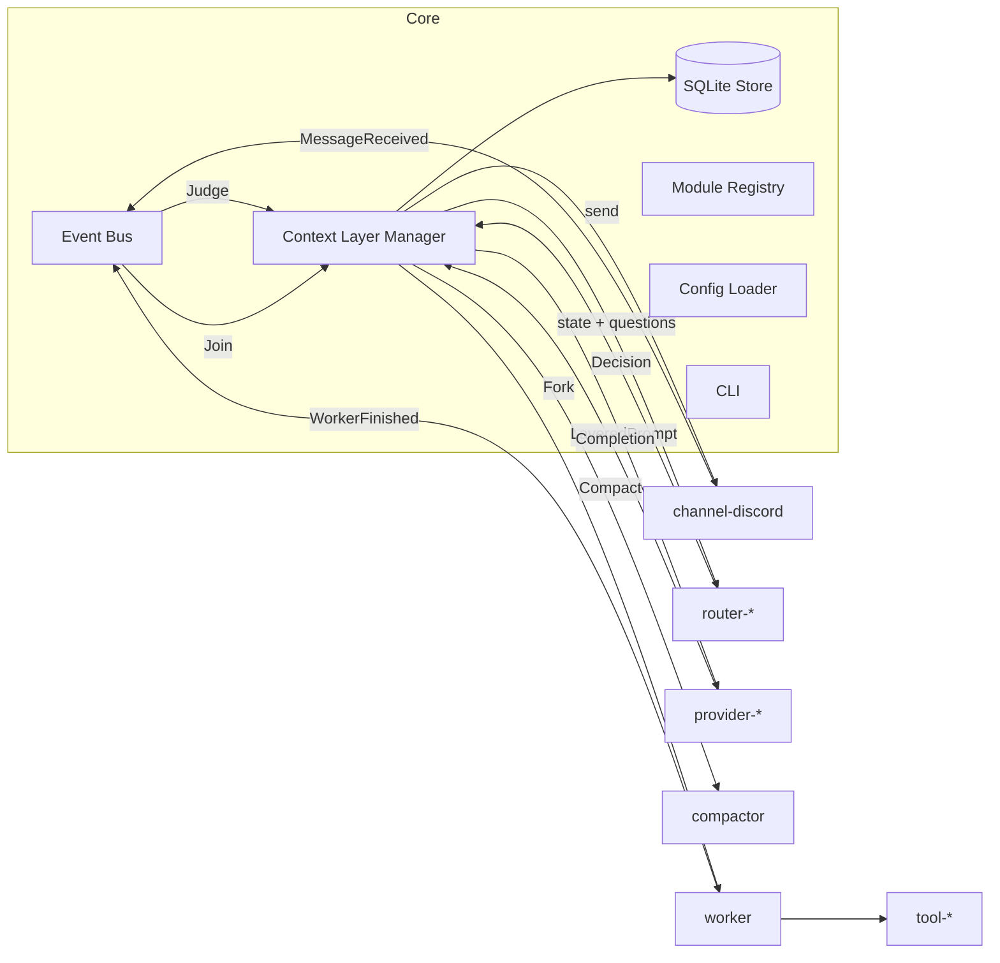

# Noth アーキテクチャ: 全体像

Noth は少人数の Discord サーバーに常駐する AI エージェントハーネスです。本書は Rust アプリケーションとしての設計原則、Core と module の全体像、Core の責務、起動シーケンス、MVP に含めない範囲を定義します。

module の一覧とクレート構成は [modules.md](modules.md)、Core が公開する trait は [traits.md](traits.md)、KV キャッシュの扱いは [caching.md](caching.md)、信頼境界と tool-shell の運用は [security.md](security.md)、採用クレートは [dependencies.md](dependencies.md) を参照してください。会話文脈の扱い(Layer 0〜4、System One による制御、ライフサイクル)は [context-layers.md](../context-layers.md)、CLI と設定ファイルは [cli.md](../cli.md) にあります。

## 1. 設計原則

1. **Core は小さく、機能は module に置く。** Core は「イベントを流す」「文脈を組み立てる」「状態を永続化する」「module を束ねる」だけを担う。Discord・LLM・System One・ツールはすべて module。
2. **必要な module だけを静的リンクする。** module の有効化は Cargo feature で行い、1バイナリに必要な分だけ含める。実行時プラグインロードや外部プロセス接続は MVP では持たない。
3. **module は Core の公開 trait にだけ依存する。** module 同士は直接参照しない。module 間のやり取りは Core のイベントバスと trait 経由に限る。
4. **module を外したときの退化動作を定義する。** 任意 module が無い構成でも Core は起動し、仕様で決めた縮退動作に落ちる。
5. **各サービスは公式の標準 API を直接使う。** LLM・System One・TinyFish はいずれも `reqwest` で公式 HTTP API を叩く。SDK やラッパーは挟まない。

## 2. 全体像

Context Layer Manager は本線の状態を持つ唯一の writer(actor)で、`Judge` / `Join` / `Compact` の仕事を1本のキューから順に処理します。並行に動くのは Worker だけです([context-layers.md §2.1](../context-layers.md#21-本線-actor-と処理単位))。

## 3. Core の責務

Core は必須で、feature 化しません。

| コンポーネント | 責務 |
|---|---|
| Config Loader | `config.toml` と `.env` の読み込み、`${VAR}` の解決、検証。解決するのは有効な module のセクションだけ |
| CLI | `noth` コマンド群。[cli.md](../cli.md) 参照 |
| Event Bus | module 間のイベント配送。`MessageReceived`、`WorkerFinished`、`IdleDetected` |
| Context Layer Manager | 本線 actor。Layer 0〜4 の構築と Append-only 保証、Fork/Join、未昇格バッファの管理、閾値による判定の二値化、Compactor の置換。本線状態の唯一の writer |
| SQLite Store | 生ログ、TopicChunk、エピソード要約、Worker 結論メモ、heartbeat の永続化。`guild_id` でキー付け |
| Module Registry | feature で組み込まれた module の初期化順序と依存解決、設定で有効化された module のみ起動 |

1プロセスで複数 guild を扱える前提でデータモデルは `guild_id` を持ちますが、MVP の設定と実装は1 guild です。

## 4. 起動シーケンス

1. Config Loader が `config.toml` と `.env` を読み、有効な module のセクションにある `${VAR}` を解決する。未定義の変数があれば起動を中止する
2. Module Registry が feature で組み込まれた module のうち、`[modules] enabled` にあるものを種別ごとに初期化する。router と provider がちょうど1つでない、または channel が0個なら起動を中止する
3. SQLite Store がマイグレーションを実行する
4. Channel が接続し、`members()` で Layer 1 のメンバー情報を取得する
5. Context Layer Manager が Layer 0(内蔵。有効な module 構成に応じた節を組み合わせる)、Layer 1(profile ファイル + メンバー情報)、Layer 2(SQLite の最新要約)、Layer 3(前回終了時の直近ターン)を復元する。進行中だった Worker を aborted にし、未昇格バッファと未判定の発言を復元する([context-layers.md §6.1](../context-layers.md#61-再起動時の復元))
6. Event Bus が動き出し、Channel からの発言を受け付ける。以後 `heartbeat` テーブルを定期更新し、`noth status` はそれを読む

設定の変更と module の有効化・無効化は再起動で反映します。実行中の差し替えは行いません。

## 5. MVP に含めないもの

| 項目 | 理由 |
|---|---|
| 外部プロセス module(MCP / JSON-RPC over stdio、Python 等) | 静的リンクだけで MVP の機能は揃う。必要になったら `Tool` / `Router` の実装として追加する |
| 動的プラグインロード(dylib / WASM) | ABI とサンドボックスの設計コストが見合わない |
| キャッシュの keep-alive(`keep_alive()` の呼び出し) | 5分 TTL の期限切れ直前に `max_tokens: 0` のダミーを投げて延命する最適化。沈黙が多い少人数サーバーでは効くが、効果の検証を MVP 後に回す([caching.md §5](caching.md#5-keep-alivemvp-外)) |
| tool のサンドボックス、対話的な承認 | 差し込み点のみ用意([security.md §3](security.md#3-web-側の対策と承認ポリシー)) |
| 設定のホットリロード | 一律再起動 |
| TUI、対話チャット CLI | Noth は Discord 常駐専用 |
